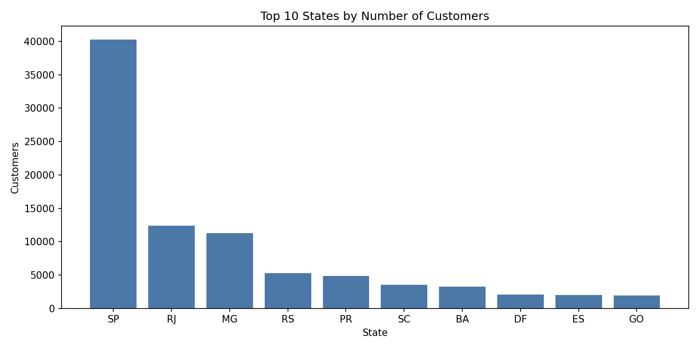
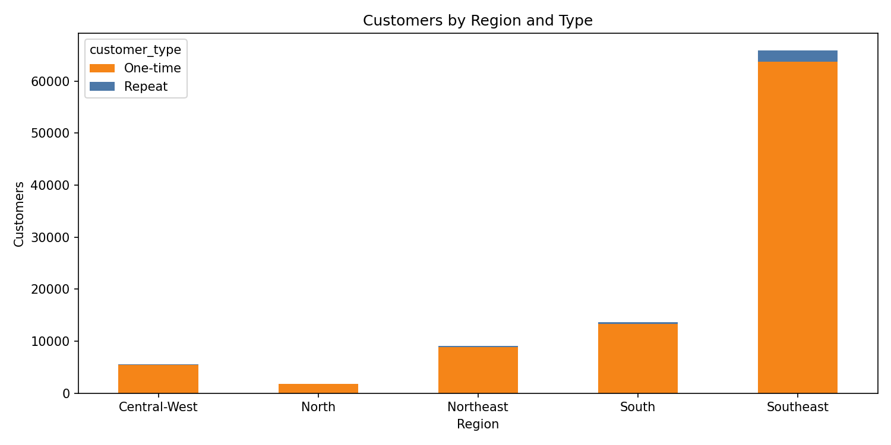
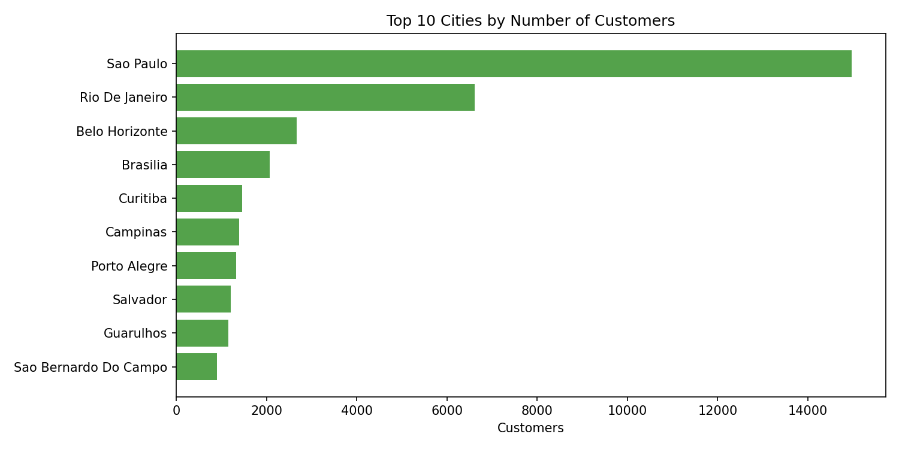

# Olist Customer Data Cleaning

Cleaning and restructuring the Olist customers table into one clean row per unique customer, with region and repeat-customer features, exported to CSV and SQLite and explored with a few charts.

## Results

| | Value |
|---|---|
| Raw records | 99,441 |
| Unique customers after cleaning | 96,096 |
| Duplicate `customer_unique_id` records collapsed | 3,345 |
| Repeat customers | 2,997 (3.12%) |
| Null values | 0 |
| Validation checks passed | 6 of 6 |

The raw data was already fairly clean: no nulls, no fully duplicated rows, every zip code prefix had 5 digits, and every state code was valid. Most of the work was standardizing text, validating fields, and restructuring the table.

## Why the table needs restructuring

In the raw file, `customer_id` is unique for every row, while `customer_unique_id` repeats (3,345 duplicates). A customer who ordered more than once therefore appears in several rows. The project collapses these into one row per person and keeps a lookup table that maps every original `customer_id` to its `customer_unique_id`.

## Cleaning steps

1. **Load as text:** read every column as a string so zip codes keep their leading zeros.
2. **Quality checks:** counted nulls (0), full duplicate rows (0), duplicate `customer_id` (0) and duplicate `customer_unique_id` (3,345).
3. **Standardize text:** trimmed whitespace, converted city names to title case with accents and extra spaces removed, and converted state codes to uppercase.
4. **Validate fields:** confirmed all zip code prefixes are 5 digits and all states belong to the 27 valid Brazilian state codes.
5. **Add region:** mapped each state to one of five regions (North, Northeast, Central-West, Southeast, South).
6. **Count orders per customer:** computed `orders_count` per `customer_unique_id`.
7. **Build the customer table:** kept one row per unique customer and added `customer_type` (`Repeat` or `One-time`).
8. **Validate the result:** six automated checks (no nulls, unique customers, 5-digit zip codes, valid states, positive order counts, complete ID map), all passed.
9. **Export:** saved the results as CSV files and as a SQLite database with two tables.

## Output tables

| File | Rows | Description |
|---|---|---|
| `customers_clean.csv` and the `customers` table | 96,096 | `customer_unique_id`, `customer_zip_code_prefix`, `customer_city`, `customer_state`, `region`, `orders_count`, `customer_type` |
| `customer_id_map.csv` and the `customer_id_map` table | 99,441 | Maps every original `customer_id` to its `customer_unique_id` |

Example SQL query used in the notebook:

```sql
SELECT region, customer_type, COUNT(*) AS customers
FROM customers
GROUP BY region, customer_type
ORDER BY customers DESC;
```

## Visualizations

### Customers by state



São Paulo (SP) dominates with roughly 40,000 customers, far ahead of Rio de Janeiro (RJ, roughly 12,000) and Minas Gerais (MG, roughly 11,000).

### Customers by region and type



The Southeast holds 68.6% of all customers (65,890 of 96,096), followed by the South (14.2%), Northeast (9.5%), Central-West (5.8%) and North (1.9%). One-time customers dominate everywhere: the repeat rate is low in every region, ranging from 2.5% in the Northeast to 3.2% in the Southeast.

### Top cities



Sao Paulo alone has roughly 15,000 customers, more than twice as many as Rio De Janeiro (roughly 6,600). The remaining cities in the top 10 each have fewer than 3,000.

## Project structure

```
olist-customer-data-cleaning/
├── data/
│   └── raw/                  place olist_customers_dataset.csv here
├── images/                   charts used in this README
├── notebooks/
│   └── olist_customer_data_cleaning.ipynb
├── requirements.txt
└── README.md
```

## How to run

1. Download `olist_customers_dataset.csv` (from the Brazilian E-Commerce Public Dataset by Olist on Kaggle) and place it in `data/raw/`.
2. Install the dependencies and open the notebook:

```bash
git clone https://github.com/menna753-afk/olist-customer-data-cleaning.git
cd olist-customer-data-cleaning
pip install -r requirements.txt
jupyter notebook notebooks/olist_customer_data_cleaning.ipynb
```

Running the notebook creates `data/processed/` with `customers_clean.csv`, `customer_id_map.csv` and `customers.db`, and saves the charts to `images/`. The raw file is not included in this repository.

## Notes

- `orders_count` counts the records (`customer_id` values) per unique customer in this table.
- 122 customers appear with more than one city and 250 with more than one zip code prefix. The cleaned table keeps the location from each customer's first record.
- Accents are removed from city names, so `São Paulo` becomes `Sao Paulo`.

## Tools

Python, pandas, NumPy, SQLite, Matplotlib
